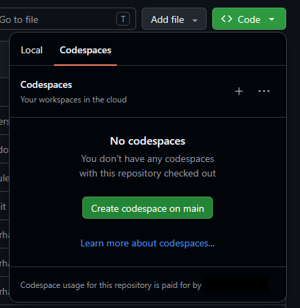
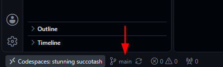
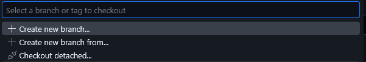
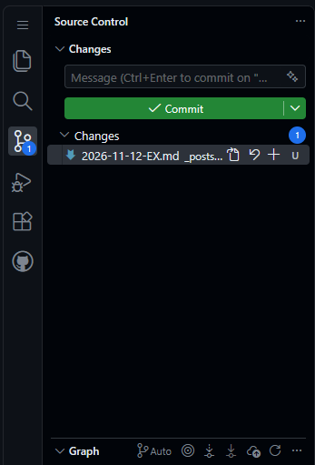
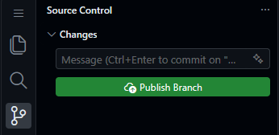
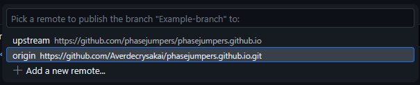
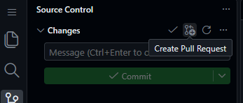

# Welcome to the Phase Jumpers Wiki!

## What Is This?

Welcome! This website is a repository for all information related to the Phase Jumpers Space Engineers Server's story and canon.

## How To Write A Post

These steps assume you have a GitHub account already made.

### Step 1: Set up your environment

1. Click the **Code** button at the top of this page (the green box), and click Codespaces > Create codespace on main. Your free account comes with 120 hours per month, and you can pick the weakest machine offered to extend that. This step should automatically open a new tab with your codespace.
   - If you already have a codespace, click on its name to open its editor. The name should be randomly generated.
   - A prompt may pop up asking you to trust the authors of the folder, which you should do.



2. Click the branch button (in the bottom left, where it says **main** currently), and select "Create new branch". When asked, name it something relevant to what you want to do, and press Enter. The branch button should now display your new branch name.





3. Go to the **_posts** folder in the repository's Explorer to the left, click to open it, and find the directory you want to add to.
   - **factions/** = for faction stories, corporations, or organizations
   - **characters/** = for character profiles (main characters, NPCs)
   - **events/** = for major historical events, battles, discoveries
   - **ships/** = for ship descriptions, blueprints, and lore
   - **just-flavor/** = for fun side stories, in universe memes, and other incidences
   - **noncannon/** = for "what if" scenarios or things you don't wish to make cannon
4. Create a new file in this format in said directory: `[YEAR]-[MONTH]-[DAY]-[TITLE].md`

(Note: If you have experience with Git and Code OSS, you can skip the codespace entirely and clone to your local instead. The codespace just makes it easier for nontechnical users.)

### Step 2: Set Up Your Post's Header
Start your file with this information block at the very top:

```
---
layout: post
title: "Your Post Title Here"
date: YYYY-M-D 
categories: category, subcategory
---
```

**Date Format:** Use `YYYY-M-D` (year-month-day).

**Categories:** Choose from the main categories below (separate multiple with commas):
- `factions` - Corporations, governments, organizations, military units
- `characters` - Main characters, NPCs, important individuals
- `events` - Battles, discoveries, historical moments, system events
- `ships` - Ship descriptions, prototypes, blueprints
  
### Step 3: Write Your Post!

Just write like you normally would. You can use:
- **Bold text** by wrapping words in asterisks: `**this is bold**`
- **Italic text** using single asterisks: `*like this*`
- **Links**: `[display text](https://example.com)`
- **Headers** with `#` (one # = biggest, ### = smaller)

You can also add images and tables if you want to get fancy!

### Step 4: Save & Submit
1. Click on the Source Control button (looks like a branch) to the left to open its panel, or press `Ctrl+Shift+G`



2. In the text box below "Changes", type a short summary like "Added new faction documentation" based on what you edited or added.
3. Press "Commit". If a prompt appears to ask if you want to stage your changes and commit directly, press "Yes".
   - You may be asked to enter a commit message here if you haven't written one already in the previous step.
4. The button to the left underneath "Changes" should have changed to "Publish Branch". Press it, and when prompted for a branch, select the `origin` option.





5. You will receive a pop-up that asks if you would like to create a pull request. Upon pressing it, it should redirect you to a new page where you can give a short summary of what you added once again.
   - If the pop-up fades, you can perform the same by hovering to the right of "Changes" and clicking the second button from the left.



6. Submit your pull request! The webmaster should review your post within 24-48 hours.

## Posting & Quality Rules

### Content Guidelines

**DO:**
- Write in complete, coherent sentences and paragraphs
- Use proper spelling and grammar
- Include relevant categories in your header
- Write from an objective point of view
- Link between pages as appropriate

**DON'T:**
- Use this wiki as a propaganda source
- Spoil events that have not completed yet
- Add offensive content

### Quality Standards

1. **Originality** - Your post should be written by you, not copied from elsewhere or generated by an LLM

2. **Relevance** - The content must fit within the phase jumpers universe and its established lore

3. **Readability** - Posts should be easy to read with proper formatting

4. **Accuracy** - Check your dates, faction names, and character details before submitting

### Before You Submit
Double-check these items:
- Is your file in the correct category folder?
- Did you include all required header information?
- Are there any spelling or grammar mistakes?


## Troubleshooting

### Common Questions

**Q: Can I edit an existing post?**  
A: Yes! Create a new file with the same path but change the date in your header and filename (use today's date). This will create a "revision" of that post.

**Q: What if I make a mistake?**  
A: Just submit a corrected version. We'll replace the old one when we approve it.

**Q: How long does review take?**  
A: Whenever the webmaster feels like, but normally 24-28 hours for new pages and most edits

**Q: Can I add images or complex formatting?**  
A: Yes. Check out Ninia Serpen's Page for examples. Otherwise, check the Jekyll wiki.

### Still Have Questions?
Open an issue on this repository with your question, or ask the webmaster on Discord.

## Thank You!

Your contributions help build the world we all play in. Every faction, character, event, and ship you document makes the Phase Jumper's universe richer for everyone.

Happy writing!