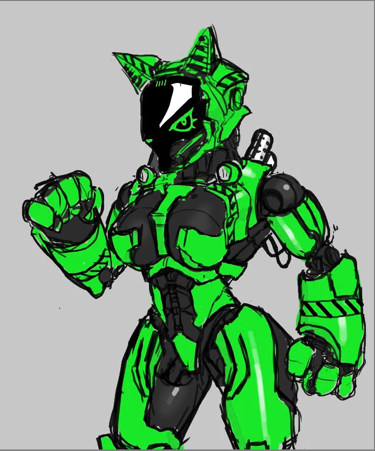

**Ninia Serpen** is one of [Triourocore's]() founders, and its current union leader/CEO, as well as one of the original CASA founders.

She is known for her strong sense of justice and citizens rights movements in-system, however her actions, especially around the first pandemic, are regarded as controversial. Some of her best known public works are the New Jormungandr space city, Homecoming colony, and Lyndwyrm relay stations.

Her personal shuttle is the Heavy VTOL *Till Death We Do Art*.

**Life in System**: Serpen appeared in the system following the Flight of the Damned disaster, alongside the TRI Cobra-class light industrial carrier, coordinating rescue efforts and pulling a part of the burn victims aboard. She then settled on Saveen, creating a small FOB and burn ward, comissioning LIM to create the blueprint for the first major station in the system, New Jormungandr. It was then constructed and the citizens moved there, with the FOB remaining abandoned to this day. Her efforts have remained on keeping the peace and constructing new projects, such as Homecoming colony, as well as the relay stations around each of the major spheres. She has directly participated in many conflicts, including the Trelan war, Radio war, Blacksite raid, and some strikes on the TFU. After the loss of her wife, she disappeared, leaving the New Jormungandr NHP to lead in her stead.

**Personal Beliefs**: Serpen has been explicit in her belief in workers rights, unionization, and personal freedoms. However, this belief is tempered by a regard for the liberties of others in addition, claiming that "your freedoms should not deny someone else their freedoms", reflected in her policy prioritizing citizen safety over personal liberty with regards to infectious disease.

**Prosthetic**: Serpen uses a full-body civilianized prosthetic, replacing her body from the neck down, minus her spine and internal organs. The prosthetic acts as a full space and planet-rated hardsuit, allowing her to operate in vacuum and in harsh environments. It has been modified extensively with off-the-shelf parts, including construction equipment, such as drills, grinders, and welders, as well as a holster for a .500 WILDCAT-brand space-hardened revolver. One of her eyes is replaced with a military grade prosthetic as well, but in depth details are currently unknown.