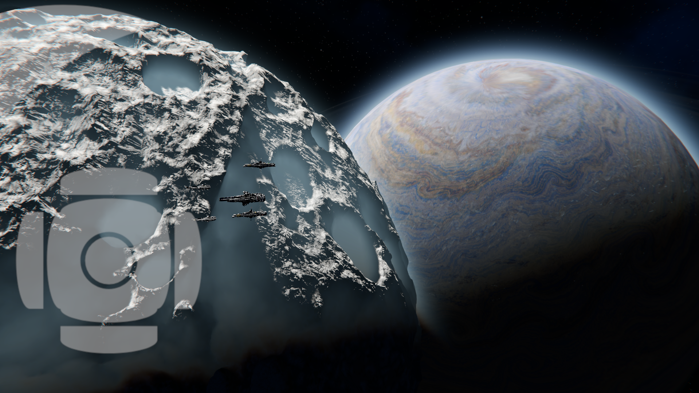

A branch of parent company StarCore, **MunCore Industries** (shortened to MunCore or MUN) is a closed-faction entity headquartered in Tarsonis space and, particularly, Korhal, colloquially known as the Mun. One of the founding members of the [Limitar Unified National Assembly [LUNA](), MunCore's stated goals as of the StarCore Colonization Project Charter are to:
- Develop the Mun into a habitable planet
- Prevent destabilization of planetary bodies in the system, through passive or active intervention.
- Operate and maintain a military branch to protect MunCore, her sovereignty, as well as her dominion over the Mun.

MunCore remains one of the only remnants of colony wave 5, 20 years before current record. Due to unknown inter-faction conflicts during wave 5, MunCore employees conducted a mass cryogenic storage event, detatching all MunCore's involvement from an otherwise untennable situation, and leaving automated systems to continue terraformation and defense in their stead. Due to outdated and failing sensor equipment, MUN remained unaware of Colony Ship "Flight of the Dammed" until two months after its' destruction, subsequently waking the few surviving MunCore employees into a system once more in turmoil.

Much of MunCore's records, technology, infrastructure, and workforce were lost in the 20 year interim. As such, MUN employs a relatively small number of specialists and workers, led by current CEO Dragon and Founder-emeritus Rover.

3 years after the Argus deconstruction, MUN began expanding its military and civilian operations to other worlds, gaining a solid foothold in system-stage politics. Since then, MunCore has remained as an administrative presence in LUNA, focused primarily on the continuation of the Mun's terraformation, as well as the recovery and development of proprietary technology and arms. With the cooperation of the other in-system factions, MunCore was able to achieve 27% of the Mun's total terraformation goal as of current day.

After discovery of the Enigma B phase gate, MUN launched the Outer Reaches Initiative, continuing its' and LUNA's expansion effort into uncharted space.

MunCore's operational divisions are denoted by colored identification bands. Disclosed divisions follow:
- Yellow: Privatized defense unit, encompassing navy, army, and air assets.
- Maroon: Subdivision of Yellow, denoting command assets.
- Blue: Non-combat production, industry, and logistics unit.
- Orange: Subdivision of Blue, used for utility craft.
- Green: Specialized planetary engineering corps.