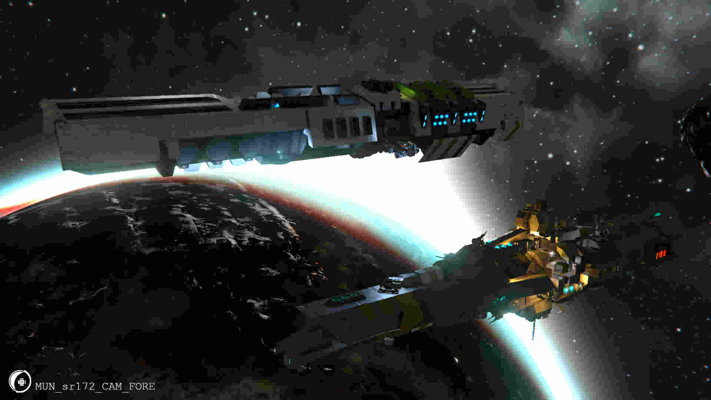

| Name: | *Some More of That Song* |
| Hull Number: | FF-148 |
| Class: | Seyfer-Class Heavy Frigate (Flight II) |
| Namesake: | [Some More of That Song (Jamie Paige)](https://jamiepaige.bandcamp.com/track/some-more-of-that-song) |
| Allegiance: | [MunCore Industries]() |
| Home port: | MUN Shipyard "Journeyman" (Korhal) |

###FF-148 on retrieval from Factorum raid in Enigma-B. Also pictured: Moray-Class Grid Transport

MUN *"Some More of That Song"* (FF-148) is a Seyfer-Class Heavy Frigate (Flight II) in service to the [MunCore]() navy. Second of her class, commissioned not long after MunCore's awakening from colony ship Flight of the Dammed, the *Some More of That Song* was among the first to recieve the Seyfer-Class Flight II refits.

During MUN's expansionist era, the *Some More of That Song* was deployed above Trelan space in defense of FOB-72 and active patrol with other commissioned LUNA ships.

As of the discovery of the Enigma B phase gate, the *Some More of That Song* was sent on long-term deployment along with the LUNA exploration force through the gate. There, she remains on permanent combat duty as LUNA pioneers set up proper shipbuilding capacity.